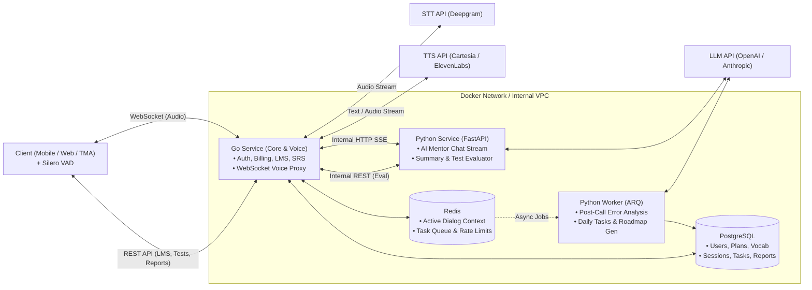
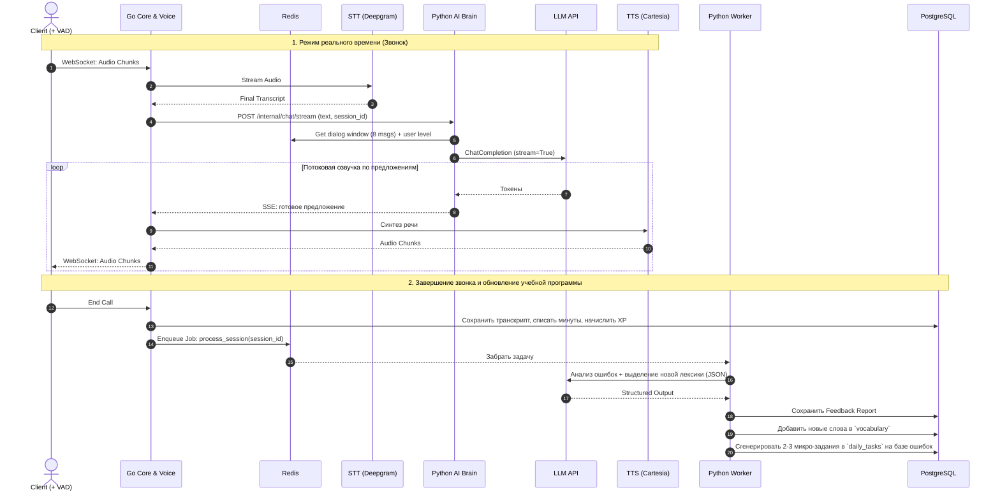

# RFC-001: Архитектура и Roadmap — AI English Learning Platform (Go + Python)

**Статус:** Draft (на обсуждении)  
**Авторы:** [Ваши имена]  
**Стек:** Go (Core API, LMS & Voice Gateway), Python / FastAPI (AI Brain & Async Workers), PostgreSQL, Redis  

---

## 1. Контекст и продуктовое видение
Создаем персонализированную платформу для изучения английского языка с AI-ментором.  

**Ключевой продуктовый цикл (Closed-Loop Learning):**
1. **Диагностика (Placement Test):** Определение стартового уровня (A1–C2) и целей ученика.
2. **Персональный трек:** Генерация программы обучения под цель (IT, переезд, путешествия, общий английский) и текущий уровень.
3. **Ежедневная практика:**
   * Интерактивные микро-задания (грамматика, лексика, тренажер слов по интервальному повторению).
   * Живые голосовые диалоги с AI-ментором на выбранные темы.
   * Тренажер аудирования (прослушивание текста и написание конспекта с AI-проверкой).
4. **Адаптация и прогресс:** Ошибки и новые слова из голосовых диалогов автоматически превращаются в персональные ежедневные задания. При накоплении прогресса открывается экзамен на подтверждение нового уровня.

**Цель MVP:** Запустить ядро продукта за 4–5 недель, проверить удержание (Retention) и сходимость юнит-экономики на первых 500–1000 пользователях.

---

## 2. Поэтапный план релизов (Product & Tech Roadmap)

Чтобы не растягивать выход на рынок на полгода, разработка делится на 3 итерации:

| Релиз | Срок | Функционал | Архитектурный фокус |
| :--- | :--- | :--- | :--- |
| **MVP (v1.0)** | Недели 1–5 | • Экспресс-тест уровня (10 вопросов + короткий голосовой спикинг) • Голосовые диалоги с AI-ментором по темам • Пост-анализ ошибок и автодобавление новых слов в словарь | Поднятие Go Voice Gateway, стриминг STT→LLM→TTS с задержкой < 1.2с, базовая БД. |
| **v1.1 (LMS)** | Недели 6–8 | • Генерация персональной программы обучения • Ежедневные задания (интервальное повторение слов + отработка ошибок из звонков) • Геймификация (стрики, XP, шкала прогресса) | Алгоритм интервального повторения (SM-2) на Go, генерация упражнений в Python Worker. |
| **v1.2 (Pro)** | Недели 9–12 | • Тренажер аудирования (прослушивание + оценка конспекта) • Итоговый экзамен на повышение уровня (Level-Up Test) | Пайплайн оценки саммари (LLM-as-a-Judge) и генерация экзаменационных билетов. |

---

## 3. Нефункциональные требования (NFR)
* **Задержка в голосовом диалоге (Voice-to-Voice Latency):** Целевая < 1.2 сек, критическая < 1.8 сек.
* **Себестоимость AI:** Не более $0.03–$0.04 за 1 минуту активного голосового диалога; фоновая генерация заданий — на дешевых моделях (`gpt-4o-mini` / `claude-3-5-haiku`).
* **Нагрузка на старте:** До 50–100 одновременных WebSocket-сессий + до 1000 DAU в режиме ежедневных заданий.
* **Сеть и платежи:** Деплой на европейский VPS (минимальный пинг до AI API) + поддержка локальных платежных шлюзов.

---

## 4. Архитектура системы (High-Level)

### Распределение ответственности между Go и Python

1. **Go Service (`core-service`):**
   * **Voice Gateway:** Прием/отправка аудио-чанков по WebSocket, стриминг в STT и TTS, таймер и посекундный биллинг минут.
   * **LMS & Progress Engine:** Выдача ежедневных заданий, алгоритм интервального повторения слов (SM-2), подсчет XP, стриков и прогресса до следующего уровня.
   * **API Gateway:** Авторизация (JWT), управление подписками, CRUD для словаря и истории уроков.
2. **Python Service (`ai-brain` — FastAPI):**
   * **Dialogue Engine:** Стриминг ответов ментора с учетом уровня ученика (A1–C2) и контекста урока.
   * **Evaluators (Синхронная оценка):** Проверка открытых ответов в Placement/Level-Up тестах и оценка конспектов после аудирования (сравнение конспекта ученика с исходным текстом по смыслу и грамматике).
3. **Python Worker (`ai-worker` — ARQ / Celery):**
   * **Post-Call Pipeline:** Разбор транскрипта после звонка, извлечение грамматических ошибок и новых слов.
   * **Content Generator:** Генерация персонального учебного плана (Roadmap), создание карточек упражнений под ошибки ученика и генерация текстов/аудио для аудирования.

---

## 5. Потоки данных (Sequence Diagrams)

### 5.1. Голосовой диалог и автогенерация заданий из ошибок

---

## 6. Схема базы данных (PostgreSQL — заложена под все релизы)

Таблицы спроектированы так, чтобы не переписывать схему при переходе от MVP к v1.2:

* **Пользователи и прогресс:**
  * `users`: `id (UUID)`, `auth_id`, `current_level (A1-C2)`, `target_level`, `learning_goal`, `xp_points (INT)`, `streak_days (INT)`, `balance_seconds (INT)`, `created_at`
  * `learning_plans`: `id`, `user_id`, `goal`, `roadmap_modules (JSONB)`, `current_module_idx`, `updated_at`
  * `level_assessments`: `id`, `user_id`, `type (placement / level_up)`, `assigned_level`, `score_breakdown (JSONB)`, `created_at`
* **Голосовой ментор:**
  * `scenarios`: `id`, `title`, `topic`, `min_level`, `system_prompt`, `is_active`
  * `sessions`: `id (UUID)`, `user_id`, `scenario_id`, `duration_sec`, `status`, `started_at`, `ended_at`
  * `messages`: `id`, `session_id`, `role (user/assistant)`, `content (TEXT)`, `created_at`
  * `feedback_reports`: `id`, `session_id`, `grammar_score`, `mistakes (JSONB)`, `new_vocabulary (JSONB)`, `summary`
* **Ежедневное обучение и словарь:**
  * `vocabulary`: `id`, `user_id`, `word`, `translation`, `context_sentence`, `repetition_stage (INT)`, `next_review_at (TIMESTAMP)`
  * `daily_tasks`: `id`, `user_id`, `scheduled_date (DATE)`, `task_type (vocab / grammar_drill / listening_summary / roleplay)`, `payload (JSONB)`, `is_completed (BOOL)`
  * `listening_materials`: `id`, `level`, `topic`, `transcript (TEXT)`, `audio_url`, `key_facts (JSONB)`

---

## 7. Архитектурные решения и компромиссы (ADR)

### ADR-1: Гибридный бэкенд (Go + Python)
* **Решение:** Go берет на себя WebSocket-стриминг звука, биллинг, LMS-логику и интервальное повторение. Python отвечает за LLM-стриминг, промпты и оценку открытых ответов/конспектов.
* **Последствия:** Максимальная производительность I/O и надежность биллинга на Go при высокой скорости разработки AI-фич на Python.

### ADR-2: Каскадный голосовой пайплайн (STT → LLM → TTS)
* **Решение:** На MVP используем каскад со стримингом по предложениям вместо дорогих Realtime S2S моделей.
* **Последствия:** Снижение себестоимости минуты в 2.5–3 раза и полный контроль над контекстом диалога.

### ADR-3: Замкнутый цикл обучения (Ошибки → Задания)
* **Решение:** Асинхронный воркер после каждого звонка автоматически создает упражнения для `daily_tasks` и карточки в `vocabulary` на основе реальных ошибок ученика.
* **Последствия:** Высокая персонализация без необходимости вручную составлять тысячи шаблонных уроков на старте.

---

## 8. Открытые вопросы для обсуждения с командой
1. **Клиент на MVP:** Выбираем Telegram Mini App / Web (быстрый старт без модерации сторов) или сразу пишем нативный/кроссплатформенный клиент (Flutter / React Native)?
2. **Формат аудио для аудирования:** Генерируем аудио заранее в S3 (дешевле, можно переиспользовать между учениками одного уровня) или синтезируем на лету?
3. **Критерий перехода на следующий уровень (Level-Up):** Считаем прогресс по сумме XP (за звонки + ежедневные задания) или делаем жесткую привязку к прохождению всех тем текущего модуля в `learning_plans`?

---

## 9. Глоссарий (Словарь сокращений)

* **ADR (Architecture Decision Record)** — запись об архитектурном решении: краткая фиксация того, почему выбрана конкретная технология или подход и на какие компромиссы пошла команда.
* **Barge-in** — механизм «перебивания» ИИ: мгновенная остановка воспроизведения голоса ментора, если пользователь начал говорить поверх него.
* **DAU (Daily Active Users)** — количество уникальных активных пользователей приложения в сутки.
* **LMS (Learning Management System)** — система управления обучением: логика выдачи уроков, ежедневных заданий, подсчета XP, стриков и контроля прогресса.
* **LLM (Large Language Model)** — большая языковая модель (например, GPT-4o-mini, Claude), выступающая «мозгом» AI-ментора и проверяющая задания.
* **NFR (Non-Functional Requirements)** — нефункциональные требования: ограничения системы по скорости ответа (latency), нагрузке, стоимости и отказоустойчивости.
* **Retention** — метрика удержания пользователей (какой процент людей возвращается в приложение на 2-й, 7-й, 30-й день).
* **RFC (Request for Comments)** — формат технического документа, вынесенного на обсуждение и ревью команды перед началом разработки.
* **S2S (Speech-to-Speech)** — мультимодальные нейросети, принимающие голос на вход и сразу отдающие голос на выход без промежуточного перевода в текст.
* **SRS (Spaced Repetition System)** — система интервального повторения (например, алгоритм SM-2), показывающая карточки со словами перед тем, как пользователь их забудет.
* **SSE (Server-Sent Events)** — технология потоковой передачи данных от сервера к клиенту поверх HTTP (используется для стриминга текста из Python в Go).
* **STT (Speech-to-Text)** — технология распознавания речи и перевода аудиопотока в текст (Deepgram, Whisper).
* **TMA (Telegram Mini Apps)** — веб-приложения, запускаемые внутри интерфейса Telegram.
* **TTS (Text-to-Speech)** — технология синтеза речи и озвучивания сгенерированного текста голосом (Cartesia, ElevenLabs).
* **VAD (Voice Activity Detection)** — алгоритм/нейросеть (например, Silero VAD) на устройстве пользователя, определяющая наличие речи в микрофоне и отсекающая тишину.

