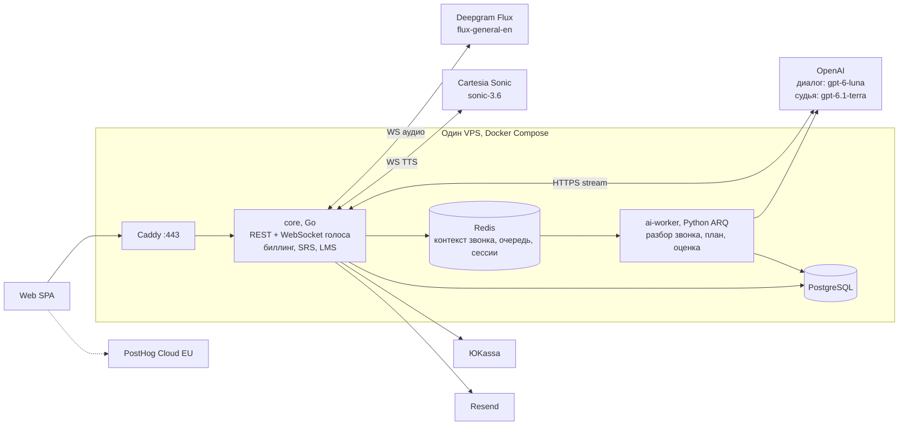
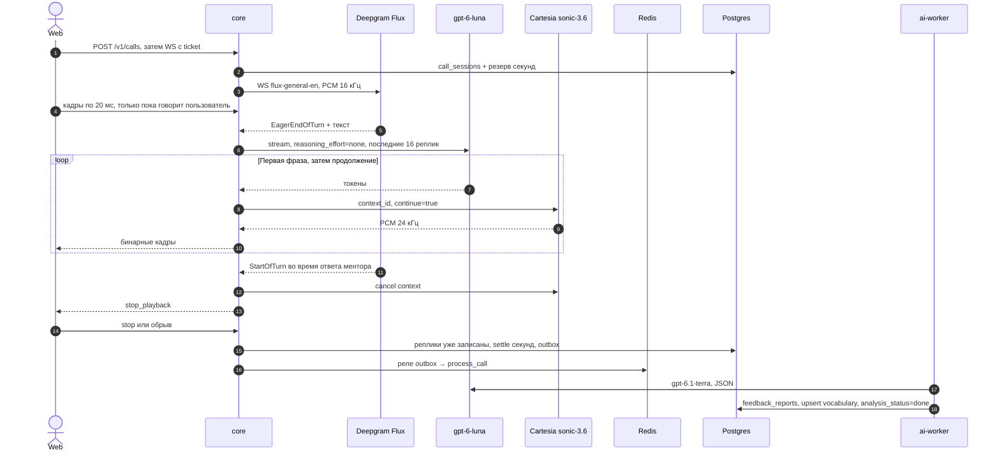

# RFC-001: Архитектура и Roadmap — AI English Learning Platform

**Статус:** Принятые решения, к реализации  
**Дата решений:** 19 ноября 2026  
**Клиент:** веб (Vite + React), не Telegram Mini App и не натив  
**Стек:** Go (`core`), Python (`ai-worker`, ARQ), PostgreSQL 16, Redis 7, один VPS  

Низкоуровневые спецификации по релизам:

- [v1.0 — голос, placement, биллинг](low-level-v1.0.md)
- [v1.1 — LMS, SM-2, план](low-level-v1.1.md)
- [v1.2 — аудирование и level-up](low-level-v1.2.md)
- [Железо, трафик и себестоимость](capacity-and-cost.md)

---

## 1. Контекст и продуктовое видение

Персональная платформа английского с AI-ментором. Продукт — замкнутый цикл, а не чат.

1. **Диагностика.** Короткий placement: закрытые вопросы и одна минутная голосовая проба. Результат — рабочий уровень A1–C2, не сертификат.
2. **Персональный трек.** Программа под цель (`it`, `relocation`, `travel`, `general`) и текущий уровень.
3. **Ежедневная практика.** Карточки SM-2, микро-задания из реальных ошибок, голосовые диалоги по сценариям, позже аудирование.
4. **Адаптация.** После звонка воркер извлекает ошибки и лексику. С v1.1 они становятся заданиями. Уровень меняется только экзаменом v1.2.

**Цель MVP:** за 4–5 недель выпустить голосовое ядро и проверить удержание и себестоимость минуты на 500–1000 пользователях.

---

## 2. Поэтапный план

| Релиз | Срок | Функционал | Что появляется в системе |
| :--- | :--- | :--- | :--- |
| **v1.0** | Недели 1–5 | Веб, magic link, placement, голосовые сценарии, отчёт после звонка, словарь без повторений, пакеты минут | `core` на горячем пути звука, `ai-worker` только после звонка, журнал секунд |
| **v1.1** | Недели 6–8 | План обучения, SM-2, ежедневные задания из ошибок, стрик и XP | Тот же воркер пишет `daily_tasks` и `learning_plans`. Новых процессов нет |
| **v1.2** | Недели 9–12 | Аудирование по готовым аудио, level-up экзамен | Тот же воркер оценивает конспект и экзамен. Появляется бакет для учебных аудио |

Задания из ошибок не входят в v1.0: в первой версии воркер сохраняет отчёт и слова. Иначе пять недель смешивают голосовой тракт и LMS.

---

## 3. Нефункциональные требования

* **Задержка голоса.** Пользовательская: от события Deepgram `EagerEndOfTurn` до первого сэмпла, который клиент начал играть. p50 < 1.2 с, p95 < 1.8 с. В замер входит клиентский буфер 60 мс.
* **Barge-in.** Локальная остановка воспроизведения < 150 мс с момента, когда клиент решил, что пользователь заговорил. Сервер следом отменяет текущий контекст Cartesia.
* **Себестоимость.** Не больше $0.04 за стенную минуту звонка при списочных ценах. Ориентир базового микса (ментор говорит около половины минуты) — около $0.02. Разбор звонка сидит в этой цифре как доля на длину сессии. Цифра считается по `call_sessions.cost_usd`, а не по прайсу в голове.
* **Нагрузка.** 50–100 одновременных звонков, до 1000 DAU. Один процесс Go это выдерживает.
* **Длина звонка.** Жёсткий потолок 15 минут. Сервер сам завершает сессию.
* **Данные.** Сырое аудио пользователя не хранится. Хранится транскрипт, пока жив аккаунт. Удаление аккаунта стирает пользователя, звонки, реплики, словарь и отчёты.

Задержка достигается так: модель отвечает с `reasoning_effort=none`, синтез стартует с первой короткой фразы (около 12 токенов или первая запятая), а не после точки. Ожидание целого предложения в бюджет 1.2 с не укладывается.

---

## 4. Архитектура

Микросервисов нет. Два процесса приложения на одном VPS плюс Postgres и Redis.

Go вызывает STT, LLM и TTS сам. Python на пути звука нет: лишний HTTP-хоп съедает бюджет задержки и не нужен, чтобы хранить промпт. Промпт сценария лежит в Postgres, обёртку собирает Go.

Python один: процесс ARQ. Отдельного FastAPI нет. Оценка конспекта и экзамена тоже задания очереди, клиент опрашивает статус через Go. gRPC, внутренняя шина и SSE между сервисами не используются.

Связь Go и воркера:

1. Go в одной транзакции с завершением звонка пишет строку в `outbox`.
2. Релей в `core` публикует её в Redis (ARQ) и помечает отправленной.
3. Воркер идемпотентен по `call_session_id`: повтор не создаёт второй отчёт и вторые слова.

### Кто за что отвечает

**`core` (Go)**

* Сессии браузера, профиль, placement как оркестрация.
* Голос: сокет, Deepgram, стрим LLM, Cartesia, barge-in, запись реплик по ходу звонка.
* Журнал секунд, резерв, пакеты ЮKassa.
* С v1.1: выдача дня, SM-2, XP, стрик.
* С v1.2: выдача аудирования и приём экзамена.
* Единственный владелец миграций (goose).

**`ai-worker` (Python, ARQ)**

* После звонка: ошибки, новая лексика, краткий summary.
* С v1.1: модули плана и 2–3 задания на звонок.
* С v1.2: тексты аудирования, оценка конспекта, оценка экзамена.
* Пишет только свои таблицы и поля, схему не меняет.

**Веб**

* Статика за Caddy. Микрофон, полудуплекс, плеер, экраны продукта.
* Аналитику шлёт в PostHog сам.

---

## 5. Голосовой поток

Реплики пишутся в `messages` на каждом финальном ходе, не в конце звонка. В Redis на время звонка лежит тот же хвост из 16 реплик и `call_session_id`. Обрыв процесса поднимает хвост из Postgres.

Пока ментор говорит, клиент не шлёт микрофон в сокет. Локальный детектор речи снимает воспроизведение и одним сообщением `barge_in` открывает микрофон. Так ментор не слышит сам себя. `echoCancellation: true` у `getUserMedia` остаётся включённым.

Конец реплики определяет Flux, не клиент. `EagerEndOfTurn` запускает ответ. `TurnResumed` отменяет ещё не озвученный ответ. `EndOfTurn` фиксирует текст пользователя.

---

## 6. Схема данных

Имена ниже — канон на все три релиза. Фаза, в которой таблица начинает жить, указана в скобках. JSON-контракты расписаны в документах фаз.

* **Аккаунт (v1.0):** `users` (`email` unique, `timezone`, `native_language`, уровни, цель, проекции `xp_points`, `streak_days`, `last_active_on`, `balance_seconds`), `login_codes`, `browser_sessions`.
* **Деньги (v1.0):** `usage_ledger` (дельта секунд, причина, `idempotency_key` unique), `payment_orders`. `balance_seconds` — проекция журнала.
* **Звонок (v1.0):** `scenarios`; `call_sessions` (статус, `end_reason`, `billed_seconds`, `analysis_status`, модели, `cost_usd`); `messages` (`seq`, unique по сессии); `feedback_reports` (один на звонок).
* **Очередь (v1.0):** `outbox`.
* **Placement (v1.0):** `placement_items`, `level_assessments` с сырыми ответами.
* **Словарь (v1.0 строки, SM-2 с v1.1):** `vocabulary` — лемма, часть речи, `ease_factor`, `interval_days`, `repetitions`, `lapses`, даты повтора, сессия-источник, unique `(user_id, lemma, pos)`.
* **План и день (v1.1):** `learning_plans` (версия, статус, модули), `daily_tasks` (`source_key` unique, `completed_at`, результат), `xp_events`.
* **Аудирование (v1.2):** `listening_materials` (ключ объекта в бакете, `key_facts`).

`sessions` из черновика переименованы в `call_sessions`, чтобы не смешивать их с браузерной сессией. `repetition_stage` удалён: это были коробки Лейтнера, а алгоритм v1.1 — SM-2.

---

## 7. Внешние интеграции

| Роль | Провайдер | Модель / протокол | Кто вызывает |
| :--- | :--- | :--- | :--- |
| STT | Deepgram | `flux-general-en`, `wss://api.deepgram.com/v2/listen` | `core` |
| Диалог | OpenAI | `gpt-6-luna`, Chat Completions, `reasoning_effort=none`, stream | `core` |
| Судья | OpenAI | `gpt-6.1-terra`, `reasoning_effort=low`, structured output | `ai-worker` |
| TTS | Cartesia | `sonic-3.6` (прод-снимок `sonic-3.6-2026-08-27`), WS, PCM s16le 24 кГц | `core` |
| Оплата | ЮKassa | пакеты минут, webhook | `core` |
| Письма | Resend | magic link | `core` |
| Продуктовая аналитика | PostHog Cloud, регион EU | события с клиента и ключевые с сервера | веб, `core` |

ElevenLabs, speech-to-speech и `gpt-4o-mini` в контур не входят. Mini уже снят с рекомендации, speech-to-speech прячет транскрипт и ломает учебный цикл, ElevenLabs на живом менторе съедает потолок $0.04.

Цены, на которых держится потолок (ноябрь 2026, список, не промо): Flux около $0.0077 за минуту аудио, Luna $0.10 / $0.50 за 1 млн токенов, Terra $1 / $5, Cartesia Sonic на тарифе Scale около $0.03 за минуту синтезированной речи. В бюджет заложена списочная цена Deepgram: промо уже отключали. Разложение минуты, трафик и сценарий на 1000 DAU — в [расчёте ёмкости](capacity-and-cost.md).

---

## 8. Инфраструктура

Аренда нужна. Отдельной платформенной команды и Kubernetes нет.

На старте арендуется:

* один VPS 4 vCPU / 8 GB RAM в Хельсинки (ориентир — Hetzner CPX31 или тот же класс);
* домен и TLS (сертификат выпускает Caddy);
* бакет объектного хранилища того же провайдера: с v1.0 туда пишутся ночные `pg_dump`, с v1.2 — готовые аудио аудирования.

На этой машине: Caddy, `core`, `ai-worker`, Postgres, Redis. Redis с AOF и `maxmemory-policy noeviction`. Порты Postgres и Redis наружу не публикуются. Managed Postgres и второй сервер — следующий шаг, когда этот ящик упрётся в CPU или диск, не раньше.

Локальная разработка — тот же Compose без публичного домена. Провайдеры в dev можно заменить ключами тех же API с низкими лимитами, отдельный мок-контур не строим.

Перед приёмом реальных пользователей отдельно проверить с юристом, обязано ли первичное хранение персональных данных граждан РФ находиться в РФ. Если да, тот же Compose переезжает на VPS в РФ, вызовы AI не меняются. Два региона в эти 12 недель не строятся.

---

## 9. ADR

### ADR-1. Два процесса, не микросервисы

Go держит деньги, сокет и продукт. Python держит промпты разбора и генерации. На 100 сокетах дробление на auth, billing, voice и lms только умножает контракты. Внутренний RPC не вводится.

### ADR-2. Горячий путь целиком в Go

`core` сам стримит Flux, Luna и Sonic. Воркер подключается после звонка. Так бюджет 1.2 с не зависит от второго языкового рантайма.

### ADR-3. Каскад, озвучка с первой фразы

STT → LLM → TTS. Синтез начинается с короткого куска, контекст Cartesia продолжается следующими чанками. Транскрипт остаётся в системе, стоимость минуты остаётся в потолке.

### ADR-4. Веб

Клиент — SPA. Микрофон в обычном браузере предсказуемее, чем WebView Telegram на iOS. Магазины приложений в эти 12 недель не нужны.

### ADR-5. Секунды — журнал

На старте звонка секунды резервируются, дальше сервер списывает тиками, в конце резерв сходится. Клиент длительность не присылает. Повторное завершение не списывает второй раз.

### ADR-6. Уровень меняет только тест

XP и стрик мотивируют. `users.current_level` пишут placement и level-up экзамен. Прохождение модуля открывает экзамен, само по себе уровень не повышает.

### ADR-7. Аудио аудирования готовится заранее

Один файл на текст в объектном хранилище. Синтез на лету повторял бы стоимость Cartesia на каждого ученика одного уровня.

### ADR-8. Конец реплики принадлежит Flux

Клиентский Silero в v1.0 не ставится. Обрыв тишины и barge-in подтверждает Flux (`StartOfTurn`, `EagerEndOfTurn`, `TurnResumed`). Клиент лишь быстро глушит динамик.

---

## 10. Принятые продуктовые решения

1. **Клиент.** Веб, Vite + React + TypeScript.
2. **Аудирование.** Заранее сгенерированные файлы, не синтез на запрос.
3. **Новый уровень.** Только экзамен v1.2. До него уровень равен результату placement.
4. **Оплата.** Пакеты минут в рублях через ЮKassa. Журнал секунд не знает провайдера: замена на Stripe — другой адаптер, не другая схема.
5. **Пробный баланс.** 5 минут на аккаунт одной проводкой журнала, чтобы удержание измерялось до первой оплаты.

---

## 11. Глоссарий

* **ADR** — запись, почему выбрано решение и чем заплатили.
* **Barge-in** — пользователь перебил ментора: плеер замолчал, синтез отменён.
* **DAU** — уникальные пользователи за сутки.
* **EagerEndOfTurn** — событие Flux: реплика, скорее всего, кончилась, ответ можно начинать раньше финального `EndOfTurn`.
* **LMS** — план, ежедневные задания, XP, стрик, допуск к экзамену.
* **NFR** — ограничения по задержке, деньгам, нагрузке и сохранности данных.
* **SM-2** — интервальные повторения с `ease_factor`, интервалом и счётчиком успешных показов.
* **SRS** — механизм, который показывает карточку до того, как слово забыто.
* **STT / TTS** — распознавание и синтез речи.
* **VAD** — детект речи. В v1.0 это энергия на клиенте плюс события Flux, не отдельная модель Silero.
